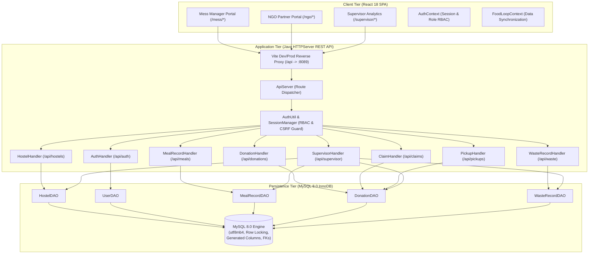
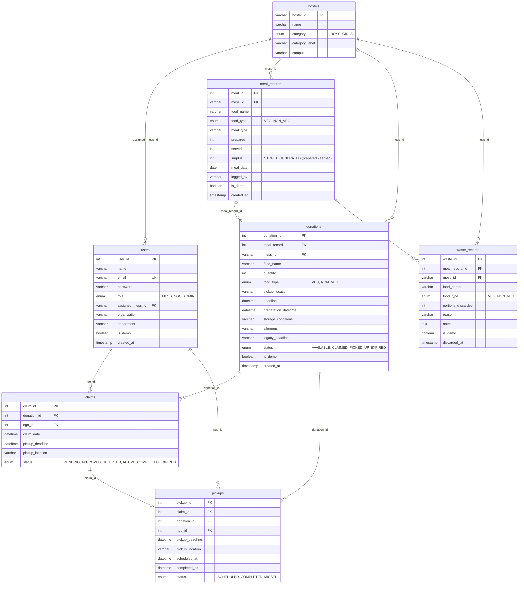

# FoodLoop — System Architecture & API Documentation

## 1. High-Level Architecture Overview

FoodLoop is designed around a decoupled, three-tier architecture that prioritizes food safety, concurrency control, and mathematical conservation of dining surplus.

---

## 2. Seven-Table Database Schema

FoodLoop's target schema enforces referential integrity, time-temperature metadata, and strict sample/demo data separation:

---

## 3. Mathematical Food Conservation Model

Every meal cohort in FoodLoop follows strict mass conservation:

$$\text{Surplus} = \max(0, \text{Prepared} - \text{Served})$$

$$\text{Surplus} = \text{Donated (Completed Pickups)} + \text{Active / Claimed Reserved} + \text{Wasted (Discard Logs)} + \text{Unallocated Remaining}$$

- **Zero Over-Allocation:** When publishing a donation, the transactional query checks:
  $$\text{New Donation Portions} \le \text{Surplus} - \sum \text{Allocated Donations} - \sum \text{Discarded Waste}$$
  If the requested volume exceeds unallocated surplus, the transaction rolls back with `HTTP 400 ValidationException`.

---

## 4. REST API Endpoint Specification

### Authentication & Sessions (`/api/auth`)
- `POST /api/auth/login`: Authenticates user with PBKDF2 / SHA-256 password hash; issues session token via HttpOnly cookie and JSON Bearer token.
- `GET /api/auth/me`: Validates session token and returns sanitized user profile.
- `POST /api/auth/logout`: Invalidates session token on server and clears cookie.

### Campus Directory (`/api/hostels`)
- `GET /api/hostels`: Returns public directory of all 7 Chitkara messes (Franklin, Alfred, Magellan, Archimedes, Pi, IBN, Nightingale).

### Meal Management (`/api/meals`)
- `GET /api/meals`: Lists meal records (scoped to assigned mess for `MESS` role; all meals for `ADMIN`).
- `POST /api/meals`: Logs a new meal batch with prepared and served quantities; surplus is auto-generated by the database.
- `GET /api/meals/{id}/allocations`: Returns full cohort mass-balance metrics (surplus, donated, reserved, wasted, unallocated).

### Surplus Donations (`/api/donations`)
- `GET /api/donations`: Lists all donation records.
- `GET /api/donations/available`: Returns unexpired available surplus donations (`status = 'AVAILABLE'`, `deadline > NOW()`, `is_demo = FALSE`).
- `POST /api/donations`: Publishes a verified unserved surplus batch with future deadline and allergen disclosures.
- `POST /api/donations/{id}/claim`: (`NGO` only) Atomically locks row (`SELECT FOR UPDATE`), verifies `is_demo = FALSE`, transitions status to `CLAIMED`, and generates scheduled pickup.

### Pickups (`/api/pickups`)
- `GET /api/pickups`: Lists scheduled and completed pickups.
- `POST /api/pickups/{id}/complete`: (`NGO` only) Confirms physical collection on-site; atomically transitions pickup to `COMPLETED` and donation to `PICKED_UP`.

### Waste Audit (`/api/waste`)
- `GET /api/waste`: Retrieves discarded food logs with reason categorization.
- `POST /api/waste`: (`MESS` only) Logs discarded kitchen surplus with audit reason (e.g. Overproduction, Expired, Quality Reject).

### Supervisor Analytics (`/api/supervisor`)
- `GET /api/supervisor/metrics`: Returns campus-wide dining totals (prepared, served, surplus, donated, wasted) excluding sample/demo records.
- `GET /api/supervisor/hostel-comparison`: Returns stacked performance metrics across all 7 Chitkara hostel messes.
- `GET /api/supervisor/waste-breakdown`: Aggregates kitchen waste by discard reason.
