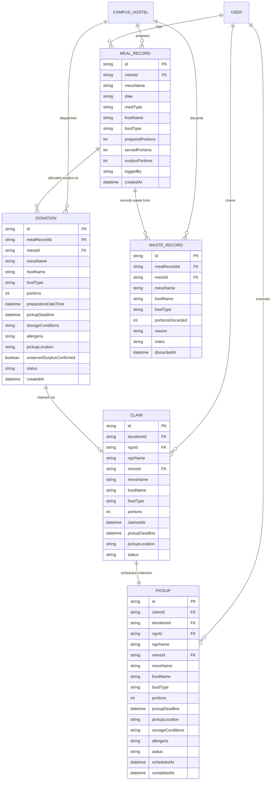

# FoodLoop — Backend Integration Readiness Specification

**Document Version:** 1.0.0 (Phase 6 Final Blueprint)  
**Campus Context:** Chitkara University, Punjab (Rajpura Campus)  
**Target Backend:** Standard Java (Spring Boot / Servlets), JDBC, MySQL  
**Frontend Stack:** React 18, Vite, React Router 6, Custom CSS3, Lucide Icons  

---

## 1. Executive Summary & Purpose

This document establishes the official technical interface contract between the completed **FoodLoop React Frontend** and the upcoming **Java & MySQL Backend (Phase 7)**.

Throughout Phases 1–5, the frontend was developed around an asynchronous, modular service layer (`authService`, `foodLoopService`, and `analyticsService`). Every method returns a `Promise` and consumes/produces standard JSON data transfer objects (DTOs). Transitioning from client-side `localStorage` persistence to live HTTP REST APIs requires swapping internal storage lookups with `fetch()` calls to standard endpoints, while preserving the verified business logic, UI layouts, and mathematical conservation models.

---

## 2. Frontend Directory Structure

```
frontend/
├── docs/
│   └── backend-integration-readiness.md   <-- [This Specification]
├── src/
│   ├── assets/                             <-- Brand photography & botanical SVGs
│   ├── components/
│   │   ├── common/                         <-- Navbar, Footer, Logo, BotanicalElements, RotatingStamp
│   │   ├── dashboard/                      <-- DashboardHeader, Sidebar (navigation & demo switcher)
│   │   ├── landing/                        <-- Hero, Problem, HowItWorks, Campus, Communities, Sustainability, CTA
│   │   ├── ngo/                            <-- DonationDetailsModal (shared inspection & claim modal)
│   │   └── ProtectedRoute.jsx              <-- Role-based route guard ('MESS', 'NGO', 'ADMIN')
│   ├── context/
│   │   ├── AuthContext.jsx                 <-- User session, active hostel selection, demo switcher state
│   │   └── FoodLoopContext.jsx             <-- Shared reactive state for meals, donations, claims, waste, pickups
│   ├── data/
│   │   ├── demoAccounts.js                 <-- Role definitions (MESS, NGO, ADMIN) & demo credentials
│   │   ├── hostels.js                      <-- Confirmed 7 Chitkara messes (4 Boys, 3 Girls)
│   │   ├── mockUsers.js                    <-- User directory & demonstration registration requests
│   │   └── researchedNgos.js               <-- Researched potential redistribution reference entities
│   ├── layouts/
│   │   └── DashboardLayout.jsx             <-- Responsive shell wrapping Sidebar, Header, and content
│   ├── pages/
│   │   ├── LandingPage.jsx                 <-- Editorial Harvest & Hope landing page
│   │   ├── Login.jsx                       <-- Credential login & 1-click quick demo buttons
│   │   ├── Register.jsx                    <-- Public partner/manager registration preview form
│   │   ├── mess/                           <-- Mess Manager Portal (Track & Donate)
│   │   │   ├── SelectHostel.jsx            <-- Dining mess selector
│   │   │   ├── MessDashboard.jsx           <-- Mess overview, dynamic metrics, active batches
│   │   │   ├── RecordMeal.jsx              <-- Form: Prepared vs Served portion logger
│   │   │   ├── MealHistory.jsx             <-- Filterable meal batches list & allocation modal
│   │   │   ├── CreateDonation.jsx          <-- Donation publisher with surplus allocation checks
│   │   │   ├── MyDonations.jsx             <-- Active, claimed, and completed donation history
│   │   │   └── RecordWaste.jsx             <-- Recorded discard logger with reason categorization
│   │   ├── ngo/                            <-- NGO Partner Portal (Claim & Collect)
│   │   │   ├── NgoDashboard.jsx            <-- Collections overview, urgent pickups, recommended batches
│   │   │   ├── AvailableFood.jsx           <-- Live surplus food discovery catalog
│   │   │   ├── RecommendedFood.jsx         <-- Capacity & dietary-filtered recommendation engine
│   │   │   ├── MyClaims.jsx                <-- Active claims directory & dispatch instructions
│   │   │   └── MyPickups.jsx               <-- Scheduled & completed collection handover log
│   │   └── supervisor/                     <-- Campus Supervisor Portal (Monitor & Improve)
│   │       ├── SupervisorDashboard.jsx     <-- Campus overview, 6 metrics, SVG charts, 7-mess bars
│   │       ├── HostelAnalytics.jsx         <-- 7-mess sortable comparison table & single mess drill-down
│   │       ├── WasteRecords.jsx            <-- Read-only waste audit log & disposal reason breakdown
│   │       ├── SupervisorDonations.jsx     <-- Campus-wide donation directory & status counter cards
│   │       ├── ClaimsPickups.jsx           <-- Handover monitoring dual-tab (Claims vs Pickups)
│   │       ├── ManageUsers.jsx             <-- User directory & demo registration requests preview
│   │       └── Reports.jsx                 <-- 5 sustainability reports, print view & RFC 4180 CSV export
│   ├── services/
│   │   ├── analyticsService.js             <-- Mathematical conservation calculations & CSV generator
│   │   ├── authService.js                  <-- Authentication adapter & session generator
│   │   ├── foodLoopService.js              <-- Central data access layer for all entities & allocations
│   │   └── storage.js                      <-- LocalStorage wrapper with in-memory fallback
│   ├── styles/
│   │   ├── global.css                      <-- Resets, buttons, cards, scrollbar, reduced-motion
│   │   ├── typography.css                  <-- Editorial typography scales, kickers, display fonts
│   │   └── variables.css                   <-- CSS custom properties (colors, shadows, radii, fonts)
│   ├── App.jsx                             <-- Router config, providers, and route definitions
│   └── main.jsx                            <-- React DOM root entry point
├── package.json
└── vite.config.js
```

---

## 3. Entity Relationships & Domain Architecture



---

## 4. Minimum Required REST API Specification (Phase 7 Scope)

### 4.1 Authentication & Session (`/api/auth`)

| Endpoint | Method | Purpose | Request Body | Response (200 OK) |
| :--- | :---: | :--- | :--- | :--- |
| `/api/auth/login` | `POST` | Authenticate user credentials | `{"email": "...", "password": "..."}` | `{"token": "JWT_OR_SESSION_ID", "user": { "id": "...", "email": "...", "role": "MESS\|NGO\|ADMIN", "name": "...", "assignedMessId": "..." }}` |
| `/api/auth/register` | `POST` | Submit registration application | `{"name": "...", "email": "...", "password": "...", "role": "MESS\|NGO", "organization": "...", "proposedMessId": "..."}` | `{"success": true, "message": "Application submitted for campus approval.", "requestId": "..."}` |
| `/api/auth/me` | `GET` | Validate current session token | Header: `Authorization: Bearer <token>` | User session object (as above) |

> **Role Convention Mapping:**
> - `MESS` $\to$ Displayed as **Mess Manager** (assigned to one of 7 campus dining halls).
> - `NGO` $\to$ Displayed as **NGO Partner** (associated with a vetted recovery organization).
> - `ADMIN` $\to$ Displayed exclusively as **Campus Supervisor** in all UI presentations.

---

### 4.2 Campus Hostels & Dining Halls (`/api/hostels`)

| Endpoint | Method | Description | Response Schema |
| :--- | :---: | :--- | :--- |
| `/api/hostels` | `GET` | Returns all 7 verified Chitkara University messes | Array of `{ "id": "mess-b-franklin", "name": "Franklin Mess", "category": "BOYS", "categoryLabel": "Boys' Hostel", "campus": "Chitkara University, Punjab (Rajpura)" }` |

---

### 4.3 Meal Preparation & Surplus Records (`/api/meals`)

| Endpoint | Method | Query / Body | Response Schema |
| :--- | :---: | :--- | :--- |
| `/api/meals` | `GET` | `?messId=...&period=...` | Array of meal records. Automatically calculates `surplusPortions = max(0, preparedPortions - servedPortions)`. |
| `/api/meals` | `POST` | `{"messId": "...", "mealType": "Lunch", "foodName": "...", "foodType": "VEG\|NON_VEG", "preparedPortions": 150, "servedPortions": 110, "date": "YYYY-MM-DD"}` | Created meal record with generated `id` and `surplusPortions`. |
| `/api/meals/{id}/allocations` | `GET` | None | `{ "mealId": "...", "surplus": 40, "donatedPortions": 25, "activeReserved": 0, "wastedPortions": 10, "remainingPortions": 5, "unallocatedSurplus": 5, "donations": [...], "wasteRecords": [...] }` |

---

### 4.4 Surplus Donations (`/api/donations`)

| Endpoint | Method | Description | Request / Response Details |
| :--- | :---: | :--- | :--- |
| `/api/donations` | `GET` | List donations. Supports filters: `?messId=...&status=AVAILABLE\|CLAIMED\|PICKED_UP\|EXPIRED&dietary=VEG\|NON_VEG`. | Array of donation objects including kitchen dispatch gate, pickup deadline, allergen declarations, and status. |
| `/api/donations` | `POST` | Publish unserved surplus batch. **Backend Validation:** Must verify that `portions <= unallocatedSurplus` for the parent meal record. | `{"mealRecordId": "...", "portions": 25, "preparationDateTime": "...", "pickupDeadline": "...", "storageConditions": "...", "allergens": "...", "pickupLocation": "Gate 1", "unservedSurplusConfirmed": true}` |
| `/api/donations/{id}` | `GET` | Fetch single donation detail. | Single donation object. |

---

### 4.5 Surplus Claims & Handover Pickups (`/api/claims` & `/api/pickups`)

| Endpoint | Method | Description | Details |
| :--- | :---: | :--- | :--- |
| `/api/donations/{id}/claim` | `POST` | NGO claims an available donation. Atomically updates donation status to `CLAIMED`, creates a `Claim`, and creates a `Pickup` scheduled record. | Request Body: `{ "notes": "..." }`. Headers identify the authenticated NGO. Fails if donation status is not `AVAILABLE` or deadline is passed. |
| `/api/pickups` | `GET` | Returns scheduled and completed pickups. `?ngoId=...&status=SCHEDULED\|COMPLETED\|MISSED`. | Array of pickup records with collection deadlines and dispatch gate coordinates. |
| `/api/pickups/{id}/complete` | `POST` | NGO confirms physical handover. Updates pickup status to `COMPLETED`, claim to `COMPLETED`, and donation to `PICKED_UP`. | Response: `{"success": true, "pickup": {...}, "completedAt": "ISO_TIMESTAMP"}`. **Triggers live update of Donated portions in Supervisor Analytics.** |

---

### 4.6 Waste Discard Audit Records (`/api/waste`)

| Endpoint | Method | Description | Details |
| :--- | :---: | :--- | :--- |
| `/api/waste` | `GET` | Returns waste logs. `?messId=...&period=...&reason=...`. | Array of waste entries with portion counts, disposal reasons, and manager audit notes. |
| `/api/waste` | `POST` | Record discarded unserved surplus. **Backend Validation:** Portion volume cannot exceed `unallocatedSurplus`. Active reservations cannot be discarded. | `{"mealRecordId": "...", "messId": "...", "foodName": "...", "foodType": "VEG", "portionsDiscarded": 10, "reason": "Overproduction", "notes": "..."}` |

---

### 4.7 Campus Supervisor Analytics & Users (`/api/supervisor`)

| Endpoint | Method | Description | Details |
| :--- | :---: | :--- | :--- |
| `/api/supervisor/metrics` | `GET` | Aggregated campus metrics grouped by source meal cohort date. `?period=TODAY\|WEEK\|MONTH\|ALL&category=ALL\|BOYS\|GIRLS&messId=...`. | `{ "totalPrepared": 300, "totalServed": 180, "totalSurplus": 120, "foodDonated": 50, "foodWasted": 30, "remainingFood": 40, "activeReserved": 25, "unallocatedSurplus": 15, "redistributionRate": "41.7%", "surplusWastageRate": "25.0%", "servingUtilisation": "60.0%" }` |
| `/api/supervisor/hostel-comparison` | `GET` | Comparative performance metrics across all 7 dining halls. | Array of 7 hostel summary records for table visualization and CSV export. |
| `/api/supervisor/waste-breakdown` | `GET` | Discard totals categorized by reason (Overproduction, Expired, Quality Reject, Spillage/Handling). | `{ "totalDiscarded": 30, "reasons": [...], "records": [...] }` |
| `/api/supervisor/users` | `GET` | List registered campus users. | Array of users with role badges, mess assignments, registration dates, and status. |
| `/api/supervisor/registration-requests` | `GET` | List pending staff and partner applications. | Array of registration preview requests. |
| `/api/supervisor/registration-requests/{id}/approve` | `POST` | Approve pending user application. | Activates the account and provisions credentials. |

---

## 5. Mock-Only Features vs. Real Backend Requirements

| Feature | Current Mock Behavior | Real Java Backend Requirement |
| :--- | :--- | :--- |
| **Demo Persona Switcher** | 1-click switcher in Sidebar & Login toggles role session in `localStorage`. | **Must be disabled** in production builds via environment variable `VITE_ENABLE_DEMO_SWITCHER=false`. Real auth uses standard session cookies / JWT tokens. |
| **Automatic Expiry** | Executed client-side during service calls (`refreshExpiredDonations`). | Server-side scheduled cron job (`@Scheduled(cron = "0 */5 * * * *")` in Spring Boot) to mark uncollected donations `EXPIRED` and missed pickups `MISSED`. |
| **User Approvals** | Frontend updates `status: 'ACTIVE'` on mock array. | Dedicated `registration_requests` table with `status ENUM('PENDING', 'APPROVED', 'REJECTED')` and supervisor audit log. |
| **Data Persistence** | Browser `localStorage` with seed JSON fallback. | MySQL relational schema with InnoDB foreign key constraints and transactional integrity (`@Transactional`). |
| **Formula Injection Defense** | Client-side CSV escaping prepending `'` to `=,+,-,@`. | Retained on client-side CSV downloads; backend sanitizes user text fields upon insertion. |

---

## 6. Preserved Scope & Postponed Features

To maintain project simplicity and clean execution, the following features remain intentionally postponed until post-launch evaluation:
1. **QR-Code Generation & Passes:** Handover is currently verified through authenticated NGO portal confirmation.
2. **Pickup Verification Codes:** SMS/OTP or 6-digit codes are postponed.
3. **Camera-Based QR Scanning:** Physical inspection and manual portal confirmation remain the approved handover method.
4. **GPS / Live Delivery Tracking:** Collection logistics remain volunteer-managed without GPS integration.
5. **Real-Time WebSockets:** REST polling or manual refresh is used for data updates.

---

## 7. Migration Checklist for Phase 7 (Java & MySQL Integration)

- [ ] Create MySQL database schema with tables: `users`, `hostels`, `meals`, `donations`, `claims`, `pickups`, `waste_records`, `registration_requests`.
- [ ] Implement Spring Boot / Java Servlet REST controllers matching the endpoints in Section 4.
- [ ] Enforce transactional consistency (`Surplus = Donated + Wasted + Remaining`) inside database transactions.
- [ ] Create a `src/services/apiClient.js` in the frontend using native `fetch()` with error interceptors.
- [ ] Update `authService.js` and `foodLoopService.js` to delegate to `apiClient.js`.
- [ ] Toggle demo switcher visibility using `import.meta.env.VITE_APP_ENV !== 'production'`.
- [ ] Run full end-to-end regression tests across all three roles.
